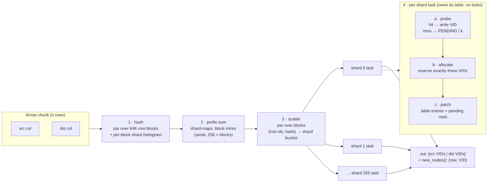

# `GidResolver`: bulk gid → VID resolution

Code: [`gid_resolver.rs`](gid_resolver.rs). VID allocation hook: `NodeStorageInner::reserve_free_range` in
`db4-storage/src/pages/node_store.rs`.

## Problem

While bulk-loading edges, every row has a `src` and a `dst` external id (gid, either an int or a
string). Each distinct gid has to be mapped to a `VID`, and each new node needs a fresh VID. Ingest
without node resolution runs at 80–100M rows/s. With the old resolution path it dropped to
4–7M rows/s.

Why the old path (`NodeResolveCache` + `bulk_load_resolve_node`) was slow:

| Cost | Old path | `GidResolver` |
|---|---|---|
| Hashes per row | `num_threads × 2`: every shard scans every row and hashes it to check `is_in_shard` | 2, computed once |
| Row access | `Box<dyn NodeColOps>` iterator, dynamic dispatch per value | typed Arrow slices, monomorphised |
| Lookup structure | per-shard LRU (`quick_cache`), then a concurrent graph-wide map on a miss | per-shard `hashbrown::HashTable`, no locks or atomics |
| New node | one `reserve_free_pos` per node (a CAS on a segment counter, slot `RwLock`) | one `reserve_free_range` per shard per chunk |
| String keys | `String` allocated per cached key | bytes appended to a per-shard arena |

## Design in one picture



### Steps 1–3: radix partition by hash

The `src` and `dst` columns are treated as one virtual array of length `2n`: index `i < n` is
`src[i]`, and index `i ≥ n` is `dst[i − n]`. Every key is hashed exactly once. The shard id comes
from 8 bits in the middle of the hash:

```
 63      57 56   48 47                                 0
┌─────────┬────────┬───────────────────────────────────┐
│ h2 tag  │ shard  │  h1 bucket index                  │
│ (7 bits,│ 8 bits │  (low bits, used by hashbrown)    │
│ SwissTbl│        │                                   │
└─────────┴────────┴───────────────────────────────────┘
```

hashbrown uses the low bits to pick a bucket and the top 7 bits as the SIMD control tag. Taking the
shard from bits 48–55 keeps it independent of both, so keys in the same shard still spread evenly
across that shard's table.

The partition is a classic two-pass parallel radix scatter:

```
blocks (64K rows each)           histograms            offsets (exclusive prefix sum,
                                                         shard-major then block-minor)
 B0: h h h h h h ...   ──►  B0: [s0:3 s1:1 s2:2 …]   ──►  s0: B0@0  B1@3  B2@5 …
 B1: h h h h h h ...   ──►  B1: [s0:2 s1:4 s2:0 …]        s1: B0@n0 B1@n0+1 …
 B2: ...                                                  …

scatter: each block writes its (row_idx, hash) pairs into its own disjoint ranges
part_idx/part_hash:  [ shard 0 rows ............ | shard 1 rows ....... | … | shard 255 rows ]
                       ascending row order within each shard (stable partition)
```

Each block writes only into ranges that belong to it, so the scatter needs no synchronisation
(it uses raw-pointer writes through `SyncPtr`). The partition is stable, so each shard sees its
rows in ascending row order. That keeps the reads of the source column mostly sequential.

### Step 4: owner-computes resolution with exact VID allocation

Each of the 256 shards is processed by exactly one rayon task (`with_max_len(1)`). Only one thread
touches a shard's hash table at a time, so lookups and inserts are plain single-threaded
`hashbrown` operations. Integer keys use one `entry()` probe. String keys use `find`, then an
arena append and `insert_unique`.

New nodes are handled in three sub-phases inside that same task, so no barrier between shards is
needed:

```
a · probe     row r: key K
               ├─ in table with real VID ─────────────► out[r] = VID
               ├─ in table with PENDING|k (seen earlier in this chunk) ─► pending_rows += (r, k)
               └─ absent ─► insert K → PENDING|k, new_keys[k] = K, pending_rows += (r, k)

b · allocate  m = new_keys.len()
              loop alloc.reserve(hint = shard_id, m_remaining) → (start, got)
              new_vids = [start .. start+got) ++ …            # exactly m VIDs, may span segments
              for k in 0..m: re-probe new_keys[k] and overwrite PENDING|k → new_vids[k]

c · patch     for (r, k) in pending_rows: out[r] = new_vids[k]
              the first pending row of each k is where node k was created → new_nodes += (r, VID)
```

`PENDING` is bit 63. VIDs never get close to 2^63, so a provisional id can't be mistaken for a
real one.

## VID allocation and node segments

VIDs encode their position: `vid = segment_id × max_segment_len + pos`. The node store keeps
`N = rayon::current_num_threads()` *free-segment slots*. Each slot points at the segment it is
currently filling. When that segment is full, a new segment is pushed and the slot moves on to it.

`GidResolver` is generic over a `VidAllocator`:

```rust
pub trait VidAllocator: Sync {
    /// reserve up to `count` consecutive VIDs; returns (first, got >= 1)
    fn reserve(&self, hint: usize, count: u32) -> (u64, u32);
}
```

The graph-backed allocator in `edges.rs` is a closure over the node store:

```rust
let vid_alloc = |hint, count| {
    let (segment, pos, got) = node_store.reserve_free_range(hint, count);
    (pos.as_vid(segment, max_node_segment_len).0 as u64, got)
};
```

`reserve_free_range(row, max_rows)` is new. It behaves like `reserve_free_pos`, except that it
reserves `min(max_rows, room_left_in_segment)` rows with a single `try_update` on the segment's
`nodes_counter`. When a segment fills up, the shard simply calls it again and continues in the next
segment.

```
slots (N = 4 here)          segments (max_segment_len = L)
slot 0 ─► seg 0  [■■■■■■■■■■■■■■■■] full ─► seg 4 [■■■■■■□□□□□□□□□□]
slot 1 ─► seg 1  [■■■■■■■■■■■□□□□□]
slot 2 ─► seg 2  [■■■■■■■■■■■■■□□□]
slot 3 ─► seg 3  [■■■■■■■■■□□□□□□□]

resolver shard s uses slot s % N, so 256 shards share N slots (256/N shards per slot).
per chunk each shard does one reserve call (two if it crosses a segment boundary):
    shard 4: reserve(hint=4, m=37) ─► slot 0 ─► seg 4, pos 6..43
```

Properties:

- **No holes or phantom nodes.** A shard reserves exactly as many rows as it has new nodes, and
  never reserves ahead speculatively. `segment_allocation_has_no_holes` checks that the reserved
  row counters sum to the number of nodes.
- **Contention is per shard per chunk, not per node.** Each chunk makes about 256 CAS operations in
  total, spread over `N` slot counters.
- **Same fill pattern as today.** Segments 0..N fill in parallel, and new segments are pushed as
  they fill up. The difference is that runs of consecutive positions in a segment belong to one
  resolver shard. This is arguably better locality for the later per-segment node writes.
- **`new_nodes()`** yields `(row, VID)` for the first occurrence of every node created by the
  chunk. With `NodeCol::get(row)` (or `get(row - n)` for dst rows), this replaces `gid_str_cache`
  for `store_node_ids`.

## Lineage: what this is built from

None of this is new. It combines well-known techniques from main-memory database engines:

- **Radix-partitioned hashing.** Partitioning by hash bits first, then building or probing a small
  table per partition, comes from radix-cluster joins:
  - Manegold, Boncz, Kersten, *Optimizing Main-Memory Join on Modern Hardware*, IEEE TKDE 2002.
  - Kim et al., *Sort vs. Hash Revisited: Fast Join Implementation on Modern Multi-Core CPUs*,
    VLDB 2009.
  - Balkesen, Teubner, Alonso, Özsu, *Main-Memory Hash Joins on Multi-Core CPUs: Tuning to the
    Underlying Hardware*, ICDE 2013. This one is the direct source for the "histogram → prefix
    sum → scatter" pattern, and for owning partitions instead of locking a shared table.
- **Partitioned hash aggregation.** Assigning dense ids to distinct keys is a `GROUP BY key`
  aggregation. DuckDB's radix-partitioned aggregate hash table and Polars' partitioned `group_by`
  use the same partition-then-aggregate shape.
- **Morsel-driven parallelism.** The 64K-row blocks are morsels:
  - Leis, Boncz, Kemper, Neumann, *Morsel-Driven Parallelism: A NUMA-Aware Query Evaluation
    Framework for the Many-Core Age*, SIGMOD 2014.
- **Owner-computes / shared-nothing.** Each partition has exactly one writer, so no locks are
  needed. This is the same idea as shard-per-core systems such as H-Store/VoltDB and Seastar.
- **SwissTable.** The per-shard table is `hashbrown`, a port of Google's Abseil SwissTable
  (Kulukundis, *Designing a Fast, Efficient, Cache-friendly Hash Table, Step by Step*,
  CppCon 2017). The shard bits are chosen to avoid the bits it uses.
- **Batched id allocation.** Reserving a range of ids per worker instead of one at a time is the
  Hi/Lo id-generator pattern, and is similar to TLABs (thread-local allocation buffers) in the
  JVM. One difference: this version reserves *after* counting, so it never over-reserves.
- **Hashing.** Integer keys use a folded 64×64→128 multiply, the mixer used by wyhash and
  foldhash. String keys use `ahash` with fixed seeds, so results are deterministic.

## Numbers

From `cargo test --release -p raphtory --lib gid_resolver::test::bench -- --ignored --nocapture`.
The workload is 10 chunks of 10M rows (20M keys each) drawn from 5M distinct u64 gids, with a
segment allocator (`N = num_threads`, `max_len = 2^20`), on the dev Mac:

| | rows/s |
|---|---|
| chunk 0 (tables growing from empty) | ~135M |
| chunks 1–9 | 340–375M |
| total | 100M rows in 484 ms |

`GidResolver::with_capacity(expected_nodes)` pre-sizes the tables and removes most of the cost
of chunk 0. String keys go through the same pipeline but haven't been benchmarked yet.

## Limitations / open items

- **Starts empty.** The resolver doesn't know about nodes already in the graph, for example from
  an earlier load or a node load. Options:
  - seed it from the graph's `gid_resolver` up front, or
  - in step 4b, check the graph mapping for each *new* key before allocating. This is one lookup
    per distinct new node, not per row.
- **The graph's gid → VID mapping isn't updated.** After the load, `new_nodes()` (or the shard
  tables) must be bulk-inserted into `graph.gid_resolver`. Alternatively, the resolver could
  become that mapping.
- **Nulls aren't checked.** The value slot is read as-is.
- **Chunk size.** It's limited to `2n ≤ u32::MAX` (u32 row indices in the partition buffers).
- **Shard count is fixed at 256.** That's plenty of parallel slack for ≤ 64 cores. Skewed degree
  distributions don't cause imbalance, because a hot node is one key and gets deduplicated
  inside its shard. Balance depends only on the hash.
- **Memory.** Integer keys cost 16 B per node in the tables, plus 16 B per row of scratch
  (hash + idx). String keys cost 32 B per node plus the key bytes.
